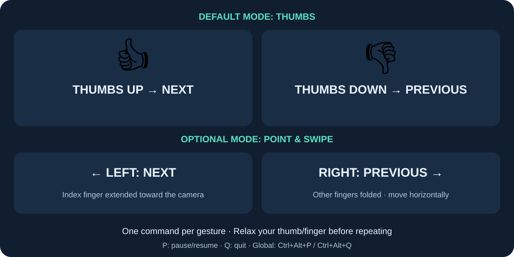

# Quick tutorial

Open **index.html** in this folder for the illustrated offline guide.

## 1. Install

Download **PPhandcontrol-windows-x64.zip** from the project's GitHub Release.
Right-click it, choose **Extract All**, and open **PPhandcontrol.exe** inside the
extracted folder. Keep `_internal`, `tutorial`, and `licenses` beside the EXE.
Do not launch it from inside the ZIP or copy the EXE out by itself.
No Python or installer is needed. Windows 10/11, an x64 CPU, and a webcam are required.

To check the download in PowerShell, run `Get-FileHash .\PPhandcontrol-windows-x64.zip -Algorithm SHA256`
and compare the result with the release's `SHA256SUMS.txt`.

## 2. Set up the camera

The app starts **paused**. Select the camera number (0 usually means the built-in
camera). Close video-call apps if the camera is busy. Keep your face and hand
well lit; put the whole hand inside the preview with the palm facing the camera.
The preview is mirrored, like a selfie camera.

## 3. Choose a viewer profile

| Viewer | Select | Prepare |
| --- | --- | --- |
| Microsoft PowerPoint desktop | PowerPoint / Google Slides | Start the slideshow with F5 or Shift+F5. Each gesture acts like one arrow-key press, including animation steps. |
| Google Slides | PowerPoint / Google Slides | Start Slideshow and click the slide. Leave browser address bars, menus, and text boxes unfocused. |
| Adobe Acrobat / Reader | Adobe Acrobat / Reader | Open the PDF and click its page area. Fullscreen (Ctrl+L) is useful. The profile uses Ctrl+PageDown / Ctrl+PageUp. |
| SumatraPDF | SumatraPDF | Open the PDF; use single-page or presentation mode, then click the page area. The profile uses PageDown / PageUp. |

The app sends keys to the currently focused program. It never switches windows
for you. Browser PDF viewers are not guaranteed to use the same keys.

## 4. Present

1. Keep **Medium** sensitivity initially. Choose **Reverse directions** only if wanted.
2. Focus the presentation/PDF. Press **Ctrl+Alt+P** to resume PPhandcontrol.
3. Open one palm and hold it still briefly. Look for tracking/ready status in the preview.
4. Swipe **left as seen in the mirrored preview** for **Next**.
5. Swipe **right as seen in the mirrored preview** for **Previous**.
6. Allow the 0.8-second cooldown, then hold still before each fresh swipe.

Use a smooth horizontal movement, not a wrist twist. Keep fingers extended and
visible. Close your palm or move it out of view while resetting its position,
then open it and hold it still again. This prevents the return movement from
looking like a deliberate opposite swipe. Low sensitivity needs a wider swipe;
High sensitivity is useful for smaller movements. Experiment before presenting.
Changing settings pauses gestures. Resume with Ctrl+Alt+P after focusing the viewer again.

Once working, minimize PPhandcontrol. Tracking and global shortcuts keep working;
the app does not take focus away from your viewer.

## 5. Pause and quit

- **Ctrl+Alt+P** pauses/resumes from any application.
- **Ctrl+Alt+Q** quits from any application and releases the webcam.
- **P**, **Q**, and the buttons perform the same actions when PPhandcontrol has focus.
- Pressing bare P/Q in a viewer does not control this app.
- Restarting always starts paused, even if you quit while active.

The window reports shortcut conflicts. If another app already owns a global
shortcut, close that app or use PPhandcontrol's buttons/focused shortcuts.

## Troubleshooting

| Problem | Try this |
| --- | --- |
| Camera unavailable/black | Check Windows Settings → Privacy & security → Camera, enable desktop camera access, close other camera apps, and select another camera number. |
| Camera stops during use | The app pauses navigation. Reconnect the camera, reselect/retry it, then resume after the preview returns. |
| Missing/broken model | Extract the complete ZIP again or use a complete source checkout. The app intentionally does not download models at runtime. |
| Gesture detected but no page change | Focus the viewer's slide/page area, select its profile, leave menus, and ensure the viewer is not elevated as administrator. Navigation is suppressed while PPhandcontrol has focus. |
| Wrong direction | Judge left/right in the mirrored preview, or change Reverse directions. |
| Missed swipes | Improve lighting, use one open hand, show every finger, hold still first, swipe horizontally, or try High sensitivity. |
| Extra/unwanted navigation | Try Low sensitivity, pause during unrelated hand movement, and close the palm while resetting position. |
| Duplicate gesture seems ignored | Wait for cooldown and hold the hand still before the next swipe. |
| Global shortcut unavailable | Another application registered it first. Close that application, restart PPhandcontrol, or use the app's buttons. |
| Windows first-run warning | The executable is unsigned. Use this repository's release and compare its SHA-256 checksum; organizational security rules may require administrator assistance. |

## Privacy, attribution, and settings

Processing stays on your computer. PPhandcontrol does not record or upload video
and includes its model for offline use. Settings are stored at
`%LOCALAPPDATA%\PPhandcontrol\settings.json`; delete that file while the app is
closed to reset preferences. Camera 0, Medium sensitivity, standard directions,
PowerPoint profile, and paused state are defaults.

Created for **Mohamed Sherif**. Free use and free redistribution are allowed;
selling copies and claiming the original work as your own are prohibited.
Retain **LICENSE**, **CREDITS.md**, and third-party notices when redistributing.
See **VALIDATION.md** for a practical rehearsal checklist.
