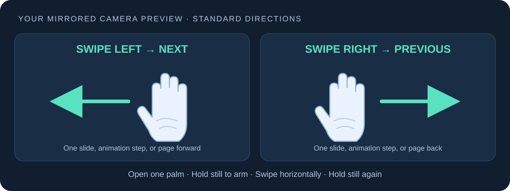

# PPhandcontrol

Control your PowerPoint presentations and PDFs with hand gestures, using only your webcam.

> [!IMPORTANT]
> **Setup takes about 2 minutes after downloading. Follow the numbered Windows steps below in order, and keep the entire app folder together.**
> This app is free and unsigned, so Windows may show a security warning on first launch. Download it only from this repository. If your device's Application Control policy blocks the EXE, contact your administrator or use the documented source setup.

**Windows 10/11 x64 · Created by Mohamed Sherif.**



Open one palm, hold it still briefly, then swipe horizontally in the mirrored
camera preview. **Left advances; right goes back.** Each swipe sends one normal
navigation command to the focused presentation or PDF viewer. PowerPoint
animations advance a step at a time, just as they do with the arrow keys.

## Download and run

**[Open the ready-to-run PPhandcontrol folder](Download/PPhandcontrol)** — it
contains **PPhandcontrol.exe**, **License.txt**, **How to use.txt**, and all required
runtime files. This folder is already extracted in the repository.

1. [Download the repository ZIP](https://github.com/mohamedsh283/PPhandcontrol/archive/refs/heads/main.zip)
   (or choose **Code → Download ZIP** on GitHub).
2. Extract it, then open **PPhandcontrol-main → Download → PPhandcontrol**.
   Keep the whole PPhandcontrol folder together, including `_internal`.
3. Open `PPhandcontrol.exe`. No Python installation or administrator access is required.
4. Choose your camera and navigation profile. The app always starts **paused**.
5. Open your presentation or PDF, start its presentation/fullscreen mode, and
   click the actual slide/document area. Press **Ctrl+Alt+P** to resume tracking.
6. Hold one open palm still, then swipe. Hold still again between swipes.

Read [How to use.txt](Download/PPhandcontrol/How%20to%20use.txt) and
[License.txt](Download/PPhandcontrol/License.txt) inside the app folder.
For a smaller download containing just the app folder, use
`PPhandcontrol-windows-x64.zip` from the
[latest GitHub Release](https://github.com/mohamedsh283/PPhandcontrol/releases/latest).

Open [`tutorial/index.html`](tutorial/index.html) in a browser for the illustrated,
offline quick guide. The [complete tutorial](tutorial/README.md) includes viewer
setup and troubleshooting. This is a Windows EXE application, not an Android APK.
The executable is unsigned; a first-run Windows reputation prompt can appear.
Download it from this repository's Releases page and check its checksum.

## Controls and settings

| Control | Action |
| --- | --- |
| Open-palm swipe left in the preview | Next slide, animation step, or page |
| Open-palm swipe right in the preview | Previous slide, animation step, or page |
| **P** while PPhandcontrol has focus | Pause/resume |
| **Q** while PPhandcontrol has focus | Quit |
| **Ctrl+Alt+P** anywhere | Pause/resume without taking focus |
| **Ctrl+Alt+Q** anywhere | Quit and release the camera |
| Pause/Resume and Quit buttons | Same actions from the app window |

- Select **Low**, **Medium** (default), or **High** sensitivity. Low requires a
  larger swipe; High accepts a smaller swipe.
- Enable **Reverse directions** if you prefer the opposite mapping.
- Changing settings pauses gestures; resume after focusing the viewer again.
- A **0.8-second cooldown** and a stable-hand rearm prevent repeated commands.
  Return to the starting position with your palm closed or out of view, then
  open it and hold still before the next gesture.
- The preview shows landmarks, tracking status, direction hints, and the last
  navigation action. The app continues processing when minimized.
- Navigation is suppressed while the app itself has focus. Focus your viewer
  before testing. P/Q are ordinary keys in other applications; only the global
  Ctrl+Alt shortcuts are registered.

Camera, sensitivity, reversed directions, and profile are stored in
`%LOCALAPPDATA%\PPhandcontrol\settings.json`. Pause state is never restored.

## Viewer profiles

| Profile | Next / previous command | Setup |
| --- | --- | --- |
| PowerPoint / Google Slides | Right / Left arrow | Start slideshow; focus the slide, outside menus and text fields |
| Adobe Acrobat / Reader | Ctrl+PageDown / Ctrl+PageUp | Open PDF; focus document area; fullscreen is helpful |
| SumatraPDF | PageDown / PageUp | Use single-page or presentation mode and focus the document |

The focused application receives the keys. PPhandcontrol does not locate or
activate a viewer. Use the matching profile and keep the viewer in front.
Browser PDF viewers and editor text fields are outside first-release compatibility.
Avoid running the viewer as administrator: Windows may prevent a normal app
from sending keys to an elevated application.

## Privacy and recognition

Camera frames are processed on your computer and are not saved or uploaded.
The bundled model allows the app to work offline; there are no runtime model
downloads, accounts, or app telemetry. The camera is released when you quit.

Recognition requires one sufficiently confident, open hand and mainly horizontal
motion. Tracking loss, multiple hands, low confidence, vertical motion, and
stationary hands do not produce navigation. Pause/resume, settings changes,
and tracking loss clear the previous movement history. Bright, even lighting
and a clear view of the whole hand improve recognition.

## Run from source

Use **64-bit CPython 3.12** with Tcl/Tk installed (the normal python.org Windows
installer includes it). From a checkout in PowerShell:

```powershell
py -3.12 -m venv .venv
.venv\Scripts\python.exe -m pip install -r requirements-dev.txt
.venv\Scripts\python.exe -m unittest discover -s tests -v
.venv\Scripts\python.exe -m pphandcontrol --self-test --report build/source-self-test.json
.venv\Scripts\python.exe -m pphandcontrol
```

Keep `models/hand_landmarker.task` with the source. Its checksum is committed
beside it; neither source launch nor packaged launch downloads a model.
Only `opencv-contrib-python` is installed because MediaPipe requires it; do not
install another OpenCV wheel into the same environment.

Build the portable executable on Windows:

```powershell
.venv\Scripts\python.exe scripts/build.py
```

The build runs the unit suite, checks the model checksum, freezes the app with
PyInstaller, smoke-tests the frozen app, and writes
`dist/PPhandcontrol-windows-x64.zip` plus `dist/SHA256SUMS.txt`. It includes
the tutorial, credits, custom license, model notice, dependency licenses, and
a smoke-test report. The dependency versions are pinned; archive entry order
and timestamps are normalized. Windows/Python/compiler differences can still
change binary bytes, so this is a repeatable build recipe, not a promise of
bit-for-bit identical EXEs across machines. See [packaging details](packaging/README.md).

## Verification and limitations

Automated tests cover synthetic swipe sequences and Windows command selection.
The offline smoke test checks Tk, imports, the bundled model, and blank-frame
inference. These checks do not establish real-camera gesture accuracy or
compatibility with every viewer. Use the [manual validation checklist](tutorial/VALIDATION.md)
to record PowerPoint animations, PDF navigation, minimized operation, hotkeys,
camera failures, and the target of at least 18/20 successful swipes each way
with no duplicate commands. Release notes state which checks were completed.

Windows CI runs tests and packages each main-branch push and pull request.
Version tags create GitHub Releases containing the ZIP and checksum.

## License and credits

Free to use, copy, modify, and redistribute free of charge under the custom
[PPhandcontrol Free Use and Attribution License](LICENSE). **Do not sell original
or modified copies, or claim the original work as your own.** Retain attribution,
the license, and credits; label modifications. The sale restriction means this
is source-available software, not OSI-approved open-source software.

Inspired by [Mahmoud Wael's hand-control project](https://github.com/mahmoudwaelali/hand-control),
with fresh application source. See [credits](CREDITS.md) and
[third-party notices](THIRD_PARTY_NOTICES.md).
